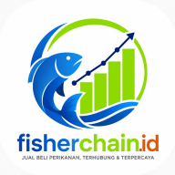
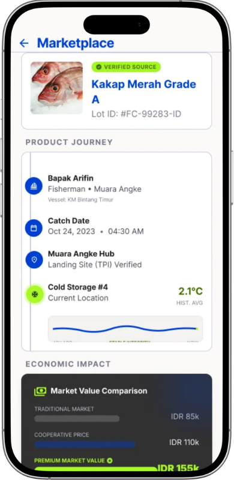
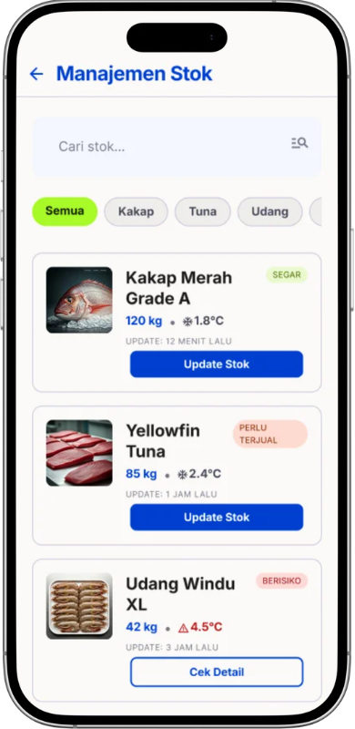
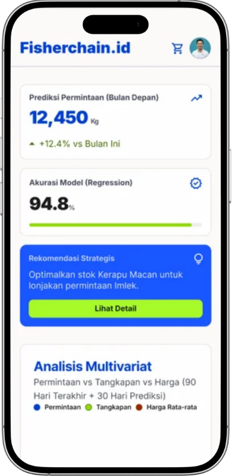
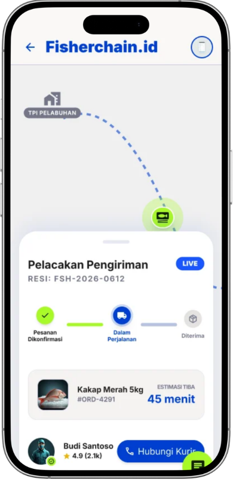
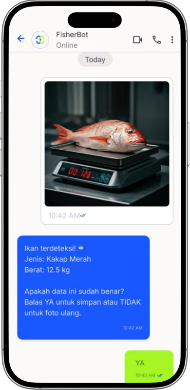

<div align="center">



# Fisherchain.id

**Rantai pasok perikanan tangkap yang transparan dan realtime — dari palka kapal hingga meja makan.**

Progressive Web App (PWA) berbasis Expo / React Native Web dengan Supabase Realtime.


</div>

---

## Daftar Isi

- [Tentang](#tentang)
- [Fitur](#fitur)
- [Tampilan](#tampilan)
- [Arsitektur & Teknologi](#arsitektur--teknologi)
- [Struktur Folder](#struktur-folder)
- [Menjalankan Secara Lokal](#menjalankan-secara-lokal)
- [Setup Supabase (Realtime)](#setup-supabase-realtime)
- [Deploy ke Vercel](#deploy-ke-vercel)
- [Install sebagai Aplikasi (PWA)](#install-sebagai-aplikasi-pwa)
- [Simulator Sensor IoT](#simulator-sensor-iot)
- [Akun Demo](#akun-demo)
- [Catatan Keamanan](#catatan-keamanan)

## Tentang

Fisherchain.id adalah *digital backbone* B2B untuk koperasi nelayan (ekosistem Kampung Nelayan Merah Putih). Platform ini menjawab tiga celah utama rantai pasok perikanan:

1. **Transparansi stok & harga** — data stok koperasi dan harga TPI tersebar realtime ke nelayan, koperasi, dan pembeli.
2. **Monitoring mutu (cold chain)** — suhu cold storage dipantau sensor IoT dengan peringatan otomatis di atas 4°C.
3. **Distribusi efisien** — pembeli (restoran/offtaker) memesan langsung dari koperasi, lengkap dengan traceability dan live tracking.

Dokumen kebutuhan produk lengkap ada di [`docs/PRD.md`](docs/PRD.md).

## Fitur

| Peran | Fitur |
| --- | --- |
| **Pembeli / Restoran** | Katalog ikan per kategori & pencarian, detail produk, keranjang & checkout (QRIS/Transfer), live tracking kurir, konfirmasi pesanan diterima, traceability asal ikan (nelayan, TPI, tanggal tangkap, riwayat suhu), scan QR |
| **Admin Koperasi** | Dashboard KPI, tren tangkapan, monitor IoT cold storage dengan alert suhu kritis, **Price Intelligence** (update harga TPI → harga produk ikut berubah di semua perangkat), pesanan terbaru realtime |
| **Nelayan (WhatsApp Bot)** | Simulasi kirim foto tangkapan di atas timbangan → AI mendeteksi jenis & berat → stok baru langsung muncul di katalog pembeli |

**Yang tersinkron realtime (Supabase):**

| Data | Tabel | Contoh efek |
| --- | --- | --- |
| Stok ikan | `products` | Nelayan konfirmasi tangkapan via bot → muncul di Beranda pembeli tanpa refresh |
| Pesanan | `orders` | Pembeli checkout → langsung tampil di dashboard admin koperasi |
| Harga TPI | `tpi_prices` | Admin ubah harga Kakap → harga di katalog semua pembeli berubah |
| Suhu cold storage | `sensor_readings` | Sensor/simulator kirim suhu → semua layar IoT ikut berubah, alert bila ≥ 4°C |

### Mode Demo (tanpa backend) — versi yang sedang di-deploy

Jika Supabase belum dikonfigurasi, aplikasi otomatis berjalan dalam **Mode Demo**:

- **Data tersimpan di browser** (`localStorage`): pesanan, stok baru dari bot WA, dan harga TPI tidak hilang saat halaman di-refresh atau PWA ditutup.
- **Sinkron realtime antar tab** di perangkat yang sama: buka dua tab/jendela — satu sebagai *Admin Koperasi*, satu sebagai *Pembeli* — lalu ubah harga atau buat pesanan; tab lain langsung ikut berubah. Suhu sensor IoT simulasi juga sama di semua tab.
- **Reset Data Demo** tersedia di menu *Profil* untuk mengembalikan data ke kondisi awal (berlaku di semua tab).
- Batasan: data tidak tersinkron antar perangkat berbeda (mis. HP ke laptop). Untuk itu, aktifkan Supabase.

Status koneksi terlihat dari badge kecil di Beranda/Dashboard: `Realtime`, `Menghubungkan`, `Offline`, atau `Demo · Sinkron Tab`.

## Tampilan

<p align="center">
  
  
  
  
  
</p>

Di layar desktop aplikasi ditampilkan dalam bingkai ponsel; di ponsel/saat di-install sebagai PWA, tampil layar penuh.

## Arsitektur & Teknologi

```
┌──────────────────────────┐        ┌───────────────────────────────┐
│  PWA (Expo → web/dist)   │        │           Supabase            │
│  React Native Web        │◄──────►│  Postgres  products, orders,  │
│  React Navigation        │  REST  │            tpi_prices,        │
│  AppContext (state)      │   +    │            sensor_readings    │
│  Service Worker (offline)│  WS    │  Realtime  postgres_changes   │
└──────────────────────────┘        └───────────────▲───────────────┘
        ▲ di-host di Vercel                          │ INSERT suhu
                                         ┌───────────┴───────────┐
                                         │ Sensor IoT / simulator │
                                         └───────────────────────┘
```

- **Frontend:** Expo SDK 58, React 19, React Native Web, React Navigation 6, lucide-react-native
- **Backend:** Supabase (Postgres + Realtime + Row Level Security)
- **PWA:** Web App Manifest, service worker (app-shell offline, cache aset ber-hash), ikon maskable
- **Hosting:** Vercel (static export dari `expo export -p web`)

## Struktur Folder

```
fisherchain.id/
├── App.js                    # Entry: provider + navigator + bingkai web
├── app.json                  # Konfigurasi Expo (termasuk web/PWA)
├── vercel.json               # Build, SPA rewrite & header cache untuk Vercel
├── .env.example              # Contoh variabel Supabase
├── public/                   # Disalin apa adanya ke hasil build web
│   ├── index.html            # Template HTML (meta PWA, manifest, OG)
│   ├── manifest.json         # Web App Manifest
│   ├── sw.js                 # Service worker
│   ├── icons/                # Ikon PWA (192, 512, maskable, apple-touch)
│   └── screenshots/          # Screenshot untuk dialog install PWA
├── src/
│   ├── assets/               # Logo & foto produk
│   ├── components/           # Button, Header, ProductCard, StatusSteps, SyncBadge, WebFrame
│   ├── constants/            # theme.js, mockData.js (data demo/fallback)
│   ├── context/AppContext.js # State global + sinkronisasi realtime
│   ├── lib/                  # supabase.js (client), pwa.js (SW), localStore.js (Mode Demo)
│   ├── navigation/           # AppNavigator (stack + tab pembeli/admin)
│   ├── screens/              # Semua layar aplikasi
│   └── services/api.js       # Query, mutasi & langganan Supabase
├── supabase/schema.sql       # Tabel, RLS, publikasi realtime & data contoh
├── scripts/
│   ├── iot-simulator.mjs     # Simulator sensor suhu → Supabase
│   └── generate-icons.cjs    # Generate ikon PWA dari logo
└── docs/
    ├── PRD.md                # Product Requirements Document
    └── screenshots/
```

## Menjalankan Secara Lokal

Prasyarat: **Node.js 20+** dan npm.

```bash
git clone https://github.com/ziker-code/fisherchain-app.git
cd fisherchain-app
npm install
cp .env.example .env        # isi kredensial Supabase (opsional, lihat di bawah)
```

| Perintah | Kegunaan |
| --- | --- |
| `npm run web` | Jalankan versi web (dev server) |
| `npm start` | Jalankan Expo — scan QR dengan **Expo Go** untuk Android/iOS |
| `npm run build:web` | Build PWA produksi ke folder `dist/` |
| `npm run preview:web` | Sajikan `dist/` secara lokal untuk uji PWA/service worker |
| `npm run iot:simulate` | Jalankan simulator sensor suhu (butuh Supabase) |
| `npm run icons` | Generate ulang ikon PWA dari `src/assets/logo.jpg` |

> Service worker hanya aktif pada build produksi (`build:web`), bukan saat `npm run web`.

## Setup Supabase (Realtime)

1. Buat proyek baru di [supabase.com](https://supabase.com) (gratis).
2. Buka **SQL Editor → New query**, tempel seluruh isi [`supabase/schema.sql`](supabase/schema.sql), lalu **Run**. Script ini membuat tabel, mengaktifkan Realtime, mengatur RLS, dan mengisi data contoh. Aman dijalankan ulang.
3. Buka **Project Settings → API**, salin **Project URL** dan **anon public key** ke `.env`:

   ```env
   EXPO_PUBLIC_SUPABASE_URL=https://xxxxxxxx.supabase.co
   EXPO_PUBLIC_SUPABASE_ANON_KEY=eyJhbGciOi...
   ```

4. Restart `npm run web`. Badge di Beranda berubah menjadi **Realtime**.
5. Uji realtime: buka aplikasi di dua tab/perangkat — satu sebagai **Admin Koperasi**, satu sebagai **Pembeli**. Ubah harga di menu *Update Harga* dan lihat harga di Beranda pembeli langsung berubah.

## Deploy ke Vercel

Konfigurasi sudah tersedia di [`vercel.json`](vercel.json) (build `npx expo export -p web`, output `dist`, SPA rewrite, header cache service worker).

**Lewat dashboard (disarankan):**

1. Buka [vercel.com/new](https://vercel.com/new) dan **Import** repo `ziker-code/fisherchain-app`.
2. Framework Preset: **Other** (pengaturan build otomatis dibaca dari `vercel.json`).
3. Tambahkan **Environment Variables**: `EXPO_PUBLIC_SUPABASE_URL` dan `EXPO_PUBLIC_SUPABASE_ANON_KEY`.
4. Klik **Deploy**. Setiap `git push` ke `main` akan otomatis di-deploy ulang.

**Lewat CLI:**

```bash
npm i -g vercel
vercel login
vercel            # preview
vercel --prod     # produksi
```

> Variabel `EXPO_PUBLIC_*` di-inline saat build, jadi setelah mengubahnya di Vercel lakukan **Redeploy**.

## Install sebagai Aplikasi (PWA)

- **Android (Chrome):** buka URL aplikasi → menu ⋮ → **Install app / Tambahkan ke layar utama**.
- **iOS (Safari):** tombol **Share** → **Add to Home Screen**.
- **Desktop (Chrome/Edge):** ikon install di address bar.

Setelah di-install, aplikasi terbuka layar penuh tanpa address bar, punya ikon sendiri, dan tetap bisa dibuka saat koneksi putus (tampilan aplikasi tersimpan di cache; badge menunjukkan **Offline** dan data realtime dimuat ulang saat aplikasi dibuka kembali dalam keadaan online).

## Simulator Sensor IoT

Tanpa perangkat keras, jalankan:

```bash
npm run iot:simulate
```

Script mengirim pembacaan suhu cold storage `CS-01` ke tabel `sensor_readings` setiap 4 detik (sesekali dengan lonjakan suhu untuk memicu alert). Layar *IoT Monitor* dan *Dashboard* menampilkan "● Sensor live". Perangkat sungguhan (mis. ESP32 + DS18B20) cukup melakukan `INSERT` yang sama melalui REST API Supabase. Jika tidak ada data sensor masuk selama 15 detik, aplikasi kembali ke mode simulasi lokal.

## Akun Demo

Di layar Masuk, pilih tombol **Simulasi Masuk Cepat**:

| Peran | Email contoh | Password |
| --- | --- | --- |
| Pembeli / Restoran | `restoran.budi@gmail.com` | `pembeli123` |
| Admin Koperasi | `admin.karangsong@koperasi.id` | `admin123` |
| Nelayan (WA Bot) | `nelayan.ahmad@wa.bot` | `nelayan123` |

Login masih berupa simulasi peran (belum memakai autentikasi sungguhan).

## Catatan Keamanan

Ini adalah **prototype kompetisi**. Kebijakan RLS di `schema.sql` mengizinkan role `anon` membaca dan menulis agar demo realtime berjalan tanpa login. Sebelum dipakai di produksi:

- Ganti login simulasi dengan **Supabase Auth** dan batasi kebijakan RLS per peran (`auth.uid()`, klaim role).
- Pindahkan operasi sensitif (update harga, status pesanan) ke Edge Function / RPC dengan validasi.
- Jangan pernah menaruh `service_role` key di aplikasi klien.

---

<div align="center">
Dibuat untuk ekosistem Kampung Nelayan Merah Putih · Fisherchain.id
</div>
